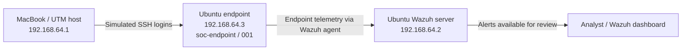
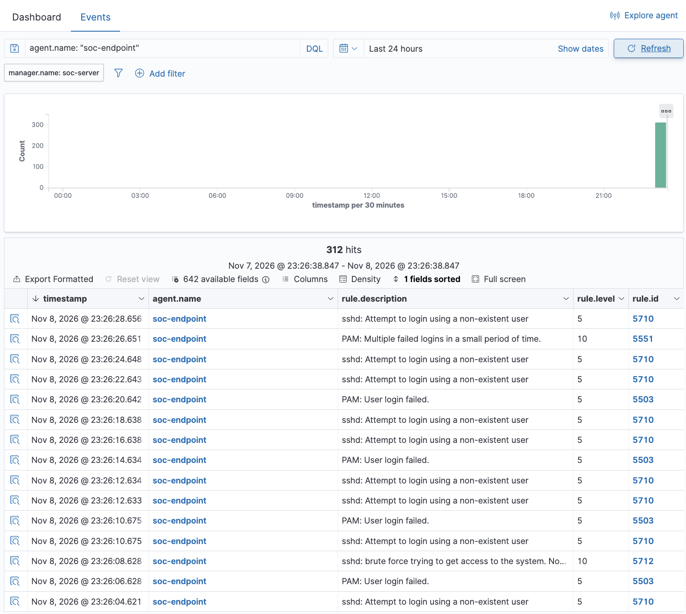

# Mini SOC Lab

A personal cybersecurity lab for practicing defensive monitoring, alert triage, and investigation with Wazuh. Built by a Computer Science student exploring SOC analysis and defensive cybersecurity.

The lab uses two Ubuntu virtual machines in UTM on an Apple M2 Pro MacBook. Three documented exercises cover an **authorized SSH brute-force simulation**, a **controlled file-integrity change**, and **Linux configuration hardening with Wazuh SCA**. They demonstrate defensive detection, investigation, and remediation practice. No successful compromise was established in the SSH exercise; the FIM exercise was an authorized test with no unauthorized attack or compromise. The hardening exercise addresses six specific cron permission findings.

## Current milestone

Three completed investigations are documented with 19 reviewed screenshots: three for SSH, two for File Integrity Monitoring (FIM), and 14 terminal/Wazuh captures for security hardening. Reports distinguish screenshot evidence from the lab owner's setup and test notes. Raw event exports have not been supplied.

## Completed investigations

| Investigation | Controlled activity | Observed detection |
| --- | --- | --- |
| [01 — SSH brute force](docs/investigations/01-ssh-brute-force.md) | Repeated failed SSH logins using a nonexistent account | Rules 5710 and 5503; correlated rules 5712 and 5551 at level 10; T1110 |
| [02 — File Integrity Monitoring](docs/investigations/02-file-integrity-monitoring.md) | Authorized modification of `critical-config.txt` in a monitored test directory | One matching modification alert; rule 550 at level 7; real-time mode; size 22 → 23 bytes; T1565.001 |
| [03 — Linux security hardening](docs/investigations/03-linux-security-hardening.md) | Targeted cron permission remediation against CIS Ubuntu Linux 24.04 LTS v1.0.0 | Checks 35594–35599 verified Passed; baseline screenshot 120 passed / 117 failed / 50%; final screenshot 126 passed / 111 failed / 53%; 42 not applicable throughout |

The FIM screenshots show metadata and integrity changes, not the file's old/new contents or proof of malicious intent. See each report for its timestamps, evidence, and limitations.

The SCA result is a verified improvement in six selected checks, not proof that the whole system is secure. Both the initial aggregate baseline and final totals are pictured in the report. No score changes before that baseline are attributed to these fixes, and 111 checks remained failed.

## Tools and environment

| Component | Role | Reported configuration |
| --- | --- | --- |
| Apple M2 Pro MacBook | UTM host and source of simulated SSH activity | Host virtual network address: `192.168.64.1` |
| UTM | Runs the two lab VMs | Version not recorded |
| Ubuntu server VM | Hosts Wazuh for monitoring and alert review | Ubuntu 24.04.5 LTS; `192.168.64.2` |
| Wazuh | Security monitoring and alert analysis | Version 4.14.10 |
| Ubuntu endpoint VM | Monitored SSH, FIM, and hardening test endpoint | Ubuntu 24.04.5 LTS; `192.168.64.3` |
| Wazuh agent | Endpoint telemetry collection | `soc-endpoint`; ID `001`; active; v4.14.10 shown in screenshot |
| SSH | Authentication service exercised in the simulation | Repeated failed logins using `soclabtest` |
| Wazuh FIM / syscheck | Monitors file attributes and integrity changes | Real-time test directory: `/home/aeden/soc-fim-lab/` |
| Wazuh SCA | Evaluates endpoint configuration against benchmark checks | CIS Ubuntu Linux 24.04 LTS v1.0.0; six cron permission checks remediated |

Addresses shown here are private lab addresses. The expanded rule 5712 event records `192.168.64.1` as the source and `192.168.64.3` as the agent address, consistent with the reported lab setup. Network isolation and external exposure have not been verified in this documentation milestone.

## Architecture



This is a logical view of the reported lab. It does not assert specific ports, firewall rules, or deployment details for individual Wazuh components.

## Repository structure

```text
mini-soc-lab/
├── README.md                              # Purpose, architecture, and learning goals
├── .gitignore                             # Excludes common secrets and private artifacts
├── docs/
│   └── investigations/
│       ├── 01-ssh-brute-force.md           # SSH simulation report
│       ├── 02-file-integrity-monitoring.md # Controlled FIM test report
│       └── 03-linux-security-hardening.md  # Cron permission remediation and SCA verification
└── evidence/
    ├── README.md                          # Collection checklist and publication review
    ├── 01-ssh-brute-force/
    │   ├── .gitkeep
    │   ├── Active_Agent.png               # Active monitored endpoint
    │   ├── Detection_Results.png          # Alert list and 312 matching records
    │   └── Investigation_Evidence.png     # Expanded rule 5712 event
    ├── 02-file-integrity-monitoring/
    │   ├── fim-detection.png              # One matching modification alert
    │   └── fim-event-details.png          # Expanded rule 550 event
    └── 03-linux-hardening/                # 14 terminal and SCA screenshots, including the baseline
```

Read the [SSH investigation](docs/investigations/01-ssh-brute-force.md), [FIM investigation](docs/investigations/02-file-integrity-monitoring.md), and [Linux hardening investigation](docs/investigations/03-linux-security-hardening.md) for findings and embedded screenshots. The [evidence guide](evidence/README.md) lists attached artifacts and remaining evidence gaps. Filenames retain their original spelling and capitalization so links also work on case-sensitive systems.

## Detection results preview



The results show rules **5712** and **5551** at level **10**, alongside rules 5710 and 5503. The view contains **312 matching alert records**. Compared with the lab owner's recorded baseline of 288, this is an increase of 24 records, **not a verified count of 24 login attempts**. The baseline screenshot is not included, and not every matching record has been attributed to the simulation. See the [full investigation](docs/investigations/01-ssh-brute-force.md) for the evidence and limitations.

## Learning objectives

- Trace endpoint authentication activity through a monitoring agent to a security alert.
- Detect file-integrity changes and distinguish observed metadata from file contents, authorization, and intent.
- Interpret SCA findings, apply least-privilege permissions, and verify targeted remediation without overstating benchmark results.
- Triage alerts using rule IDs, severity, host identity, and authentication context.
- Correlate related records without treating alert totals as login-attempt counts.
- Relate observed behavior to MITRE ATT&CK using evidence appropriate to the mapping.
- Write findings that distinguish observations, interpretation, and unanswered questions.
- Prepare useful portfolio evidence while protecting credentials and personal information.

## Connection to defensive cybersecurity and SOC work

This exercise follows a small part of a SOC analyst's workflow: recognize suspicious authentication activity, identify the affected asset, examine related alerts, assess what the evidence supports, and document next steps. Wazuh reported both individual authentication failures and correlated alerts during the exercise.

The FIM exercise extends that workflow to stored data: identify the changed file, interpret size/hash changes, check whether the modification was authorized, and compare against a trusted baseline. A file-change alert alone does not determine whether the change was malicious or affected a running service.

The SCA exercise adds configuration assessment and remediation verification. It demonstrates how to connect a failed check to a scoped permission change, verify the local result, and confirm closure in Wazuh while tracking the findings that remain open.

In an operational SOC, similar activity would require validating the source and account context, checking for successful authentication, assessing impact, and escalating or responding according to the organization's procedures. Here, the activity was intentionally generated in a personal lab. Detection alone does not demonstrate prevention, a compromise, or a complete production incident response process.

## Evidence and publication safety

The screenshots were reviewed for publication. They show private lab IP addresses, lab hostnames (`soc-endpoint` and `soc-server`), agent ID, the synthetic SSH username, and event metadata. No passwords, credentials, or public IP addresses were found. The FIM and hardening evidence retain the local username **`aeden`** in paths, group metadata, or terminal prompts; this is a personal identifier. The SSH phrase “Failed password” and the hardening screenshot's sudo password prompt do not reveal password values. Full raw log files have not been added. The ignore rules reduce accidental inclusion of common sensitive artifacts, but every future file still needs manual review before publication. Follow the [evidence publication checklist](evidence/README.md#publication-review).

## References

- [Wazuh data analysis documentation](https://documentation.wazuh.com/current/user-manual/ruleset/) describes alert analysis and storage.
- [MITRE ATT&CK: T1110 — Brute Force](https://attack.mitre.org/techniques/T1110/) provides the technique reference used in the investigation.

These references explain the tools and technique; they do not verify the lab's reported results.
