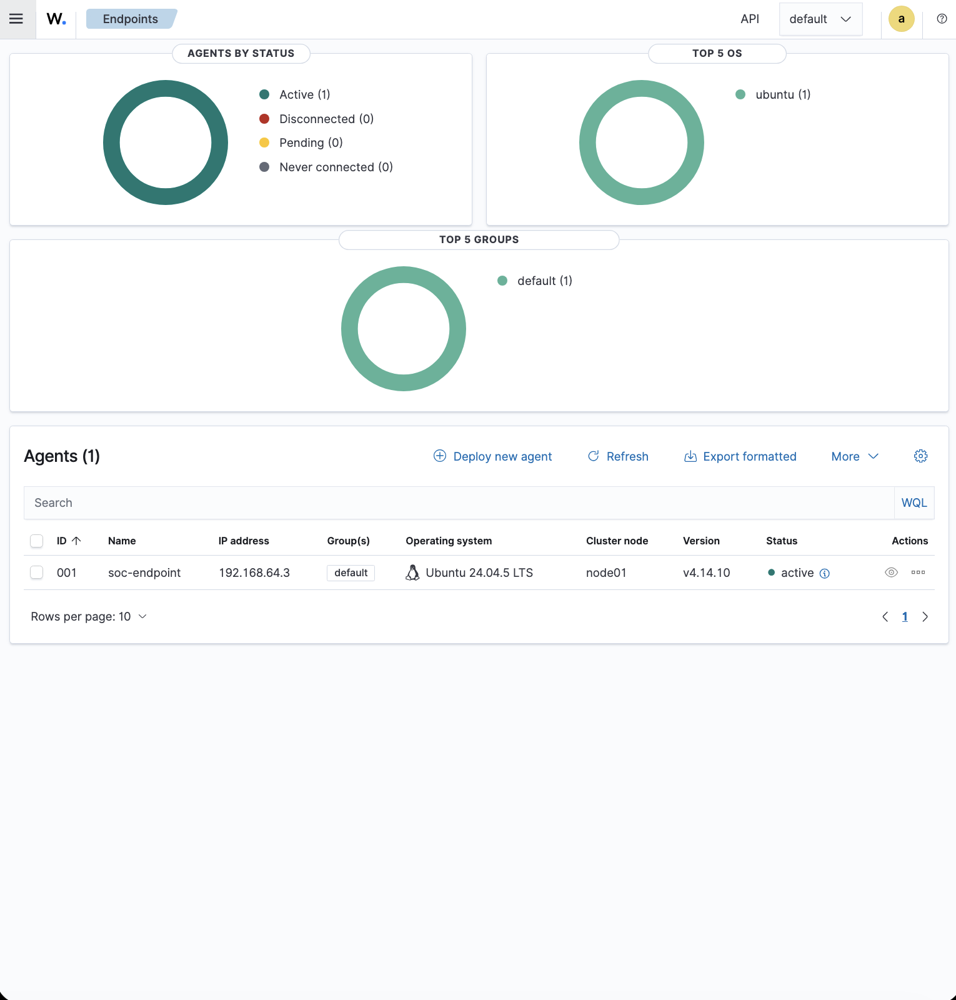
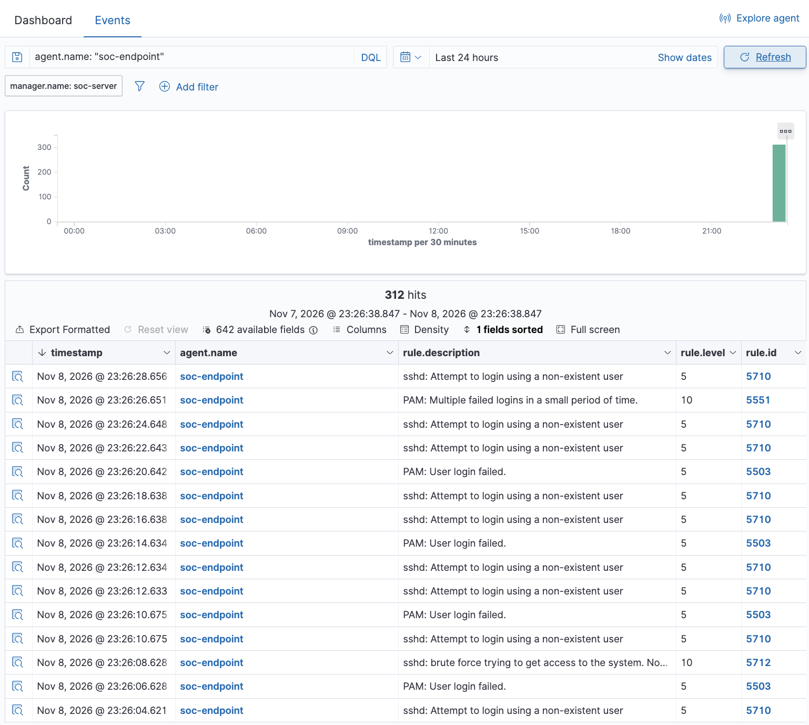
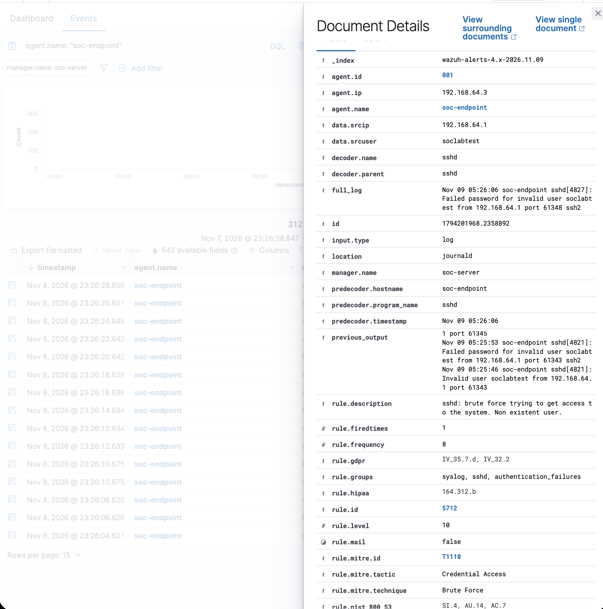

# Investigation 01: Simulated SSH Brute-Force Activity

## Case summary

| Field | Detail |
| --- | --- |
| Case ID | MINI-SOC-001 |
| Exercise type | Authorized simulation in a personal lab |
| Target | Ubuntu endpoint, `192.168.64.3` |
| Monitored agent | `soc-endpoint`, ID `001`; active in the agent screenshot |
| Activity source | Lab owner's MacBook; `192.168.64.1` appears as `data.srcip` in the expanded event |
| Targeted account | `soclabtest` — nonexistent account used for testing |
| Detection platform | Wazuh 4.14.10 on Ubuntu 24.04.5 LTS, `192.168.64.2` (lab owner's configuration notes) |
| Endpoint OS and agent version | Ubuntu 24.04.5 LTS; agent v4.14.10, visible in the agent screenshot |
| Highest visible alert level | 10, on rules 5712 and 5551 |
| ATT&CK technique | T1110 — Brute Force, visible on the expanded 5712 event |
| Displayed event times | Nov 8, 2026, approximately 23:26 in the results list; timezone not shown |
| Outcome | Failed authentication and correlated alerts observed; no successful compromise established |
| Documentation status | Supplied screenshots reviewed and embedded; remaining evidence gaps documented |

## Executive summary

The lab owner generated repeated failed SSH logins from a MacBook to a monitored Ubuntu endpoint using the nonexistent username `soclabtest`. The screenshots show Wazuh alerts for invalid-user login attempts, PAM authentication failures, and repeated authentication failures consistent with a brute-force pattern. Rules 5712 and 5551 are both visible at level 10.

The lab owner's notes record a dashboard count increase from 288 to 312, a difference of **24 additional alert records**. The attached results screenshot confirms the later total of 312; the baseline of 288 is not pictured. These totals do not establish that 24 login attempts occurred, or that every additional record was caused by the exercise. No successful compromise was established from the available evidence.

This was an authorized simulation in a personal lab. The screenshots document the resulting detections; the authorization and activity-generation context come from the lab owner's account.

## Scope and evidence basis

The investigation covers the reported SSH simulation against `soc-endpoint` and the related Wazuh observations. It does not assess other hosts or establish the overall security of either VM.

Three supplied screenshots were inspected: the agent status page, the filtered detection results, and an expanded rule 5712 event. They are embedded below with explanations of what each supports. No separate alert JSON exports, endpoint log files, exact simulation command, or successful-authentication review were supplied. The expanded event contains a visible log excerpt, but it does not replace a complete authentication-log review.

The expanded event records `data.srcip: 192.168.64.1`, `data.srcuser: soclabtest`, and `agent.ip: 192.168.64.3`. These values match the reported host virtual network address, synthetic account, and target endpoint. This verifies the source address for the displayed event; it does not establish that every record in the dashboard has the same source.

## Investigation questions

1. Did Wazuh detect failed SSH authentication against the monitored endpoint?
2. Did repeated failures generate correlated alerts?
3. What can the observations establish about activity volume and outcome?
4. What evidence remains unavailable for a more complete review?

## Activity and observations

The following sequence combines the lab owner's notes with the screenshots. It is not a complete event timeline.

| Stage | Observation | Evidence and limitation |
| --- | --- | --- |
| Baseline | Dashboard count was reported as 288 | Lab owner's notes; baseline capture not supplied |
| Simulation | Repeated failed SSH logins to `192.168.64.3` using `soclabtest` | Operator notes and failed-authentication excerpt; exact command, start/end times, and attempt count unavailable |
| Detection | Rules 5710, 5503, 5712, and 5551 appear for `soc-endpoint` | Detection results screenshot; only the displayed rows have been reviewed |
| Brute-force alert | Rule 5712, level 10, at displayed time 23:26:08.628 on Nov 8, 2026 | Results list and expanded event; expanded event shows frequency 8 and T1110 |
| Multiple-failure alert | Rule 5551, level 10, at displayed time 23:26:26.651 on Nov 8, 2026 | Results list; expanded 5551 details not supplied |
| Follow-up view | 312 matching records | Visible for the displayed last-24-hours query; not a count of SSH attempts |
| Outcome assessment | No successful compromise was established | No documented search for successful authentication or post-authentication activity |

### Detection details

| Rule ID | Visible description | Visible level | Supporting evidence |
| --- | --- | --- | --- |
| 5710 | sshd: Attempt to login using a non-existent user | 5 | Detection results |
| 5503 | PAM: User login failed. | 5 | Detection results |
| 5712 | sshd: brute force trying to get access to the system. Non existent user. | 10 | Results list and expanded event; `rule.frequency: 8` |
| 5551 | PAM: Multiple failed logins in a small period of time. | 10 | Detection results |

The rule descriptions and levels above reflect the screenshots. In particular, the results list identifies rule 5503 as “PAM: User login failed.”; the earlier notes summarized it as a PAM authentication failure.

The visible frequency value of 8 for rule 5712 is rule metadata. It is not used to calculate a total number of SSH sessions, password submissions, or login attempts. The installed rule's full correlation conditions and time window have not been reviewed. Level 10 describes the alert level; it does not establish a successful intrusion or business impact.

### Time and query context

The detection view uses `agent.name: "soc-endpoint"` with a `manager.name: soc-server` filter. It shows **312 hits** over the displayed range **Nov 7, 2026 @ 23:26:38.847 – Nov 8, 2026 @ 23:26:38.847**, labeled “Last 24 hours.” The visible rows span 23:26:04.621 through 23:26:28.656 on Nov 8; this is only the displayed portion of the results, not the full simulation window.

The expanded event's `full_log` and `predecoder.timestamp` show **Nov 09 05:26:06**, and its index is `wazuh-alerts-4.x-2026.11.09`. The screenshots do not show timezone settings or a normalized event timestamp for comparison. The difference between the dashboard and raw-log time displays remains unresolved; no timezone conversion or clock error is assumed. Capture times are not established by the screenshots.

## Screenshot evidence

### 1. Active monitored endpoint

The agent list confirms `soc-endpoint`, ID `001`, at `192.168.64.3` is active at capture time. It also shows Ubuntu 24.04.5 LTS and agent v4.14.10. This supports the monitored asset's identity and status; it does not prove uninterrupted monitoring throughout the exercise.

### 2. Detection results

This view confirms that rules 5710, 5503, 5712, and 5551 appear for `soc-endpoint`, with both correlated-failure rules, 5712 and 5551, at level 10. The query returns 312 alert records for the displayed window. It does not establish 312 login attempts or independently verify the earlier baseline of 288.

### 3. Expanded brute-force event

The expanded event confirms rule `5712`, level `10`, frequency `8`, and MITRE ATT&CK `T1110` (Brute Force), under Credential Access. It ties agent `001` / `soc-endpoint` at `192.168.64.3` to source `192.168.64.1` and user `soclabtest`. The `sshd` log excerpt reports a failed password for an invalid user; `location` is `journald`. This supports failed authentication and the rule's detection context, without demonstrating successful access or revealing a password value.

## Analysis

**Detection:** The invalid-user and PAM alerts show that Wazuh detected failed authentication activity on the monitored endpoint. Rules 5712 and 5551 show that repeated-failure detection also occurred. The expanded 5712 record connects the source, target, synthetic username, and failed SSH authentication. Full exports would be needed to correlate all relevant records and establish event coverage.

**Volume:** The reported difference is `312 - 288 = 24` alert records. The screenshot confirms 312 matching records for an agent/manager query, not an SSH-only query. The baseline's time range and filters have not been verified, and the supplied evidence does not establish a one-to-one relationship between records and attempts. The login-attempt count remains undetermined.

**Technique:** The expanded event explicitly maps rule 5712 to [MITRE ATT&CK T1110 — Brute Force](https://attack.mitre.org/techniques/T1110/). Here, the exercise used a nonexistent account to produce failed SSH authentication and trigger detection. The mapping describes the simulated behavior; it does not establish credential theft or successful access. No sub-technique is asserted.

**Outcome:** No successful compromise was established. Failed-login alerts alone cannot prove that no successful access occurred elsewhere in the time window. No search for successful authentication, post-authentication activity, or persistence was supplied, so this report makes no findings about those checks.

## Disposition and response

**Disposition:** Authorized simulation with screenshot evidence of the intended authentication-failure detection pattern. It should not be treated as an unauthorized intrusion solely because it generated high-level alerts.

No containment, blocking, account lockout, configuration changes, or remediation actions were reported. Detection and prevention are separate outcomes; this exercise documents detection only.

## Remaining evidence gaps

The documentation of the supplied screenshots is complete. These items would strengthen the investigation but are not claimed as completed:

- Original baseline capture showing 288, including its query and time range.
- Sanitized alert exports and endpoint authentication records for the full exercise window.
- Expanded rule 5551 event details and the installed rule 5712 correlation conditions/time window.
- Dashboard and endpoint timezone settings, event-time normalization, and capture times.
- Recoverable original simulation command, exact start/end times, and a defensible login-attempt count.
- A documented search for successful authentication and related activity in a defined window.

See the [evidence inventory and collection guide](../../evidence/README.md) for details. If original evidence is unavailable, record that limitation. Any later repeat must be identified as a separate run rather than historical proof for this one.

## Evidence publication review

The three screenshots were reviewed visually. No passwords, authentication tokens, private keys, public IP addresses, or unrelated personal information were found. Visible identifiers are lab hostnames, private lab addresses, the synthetic account, agent identifiers, and event metadata. The phrase “Failed password” is a log message, not a disclosed password. This review covers the supplied artifacts, not future evidence or the security of the running VMs.

Embedded EXIF/XMP metadata was also inspected. It contains image dimensions/resolution, a generic “Screenshot” comment, and XMP toolkit metadata; no sensitive identifiers or credentials were found. The image files were preserved without modification.

## Lessons learned and SOC relevance

The exercise connects authentication telemetry with alert triage and investigation writing. Individual failures provide context; correlated alerts help draw attention to repeated activity. Analysts still need to validate the source, account, timing, and outcome before making an incident determination.

The main reporting lessons are to distinguish alert records from attempts, distinguish detection from compromise, and state evidence gaps directly. These habits support reliable escalation and handoff in a SOC.
