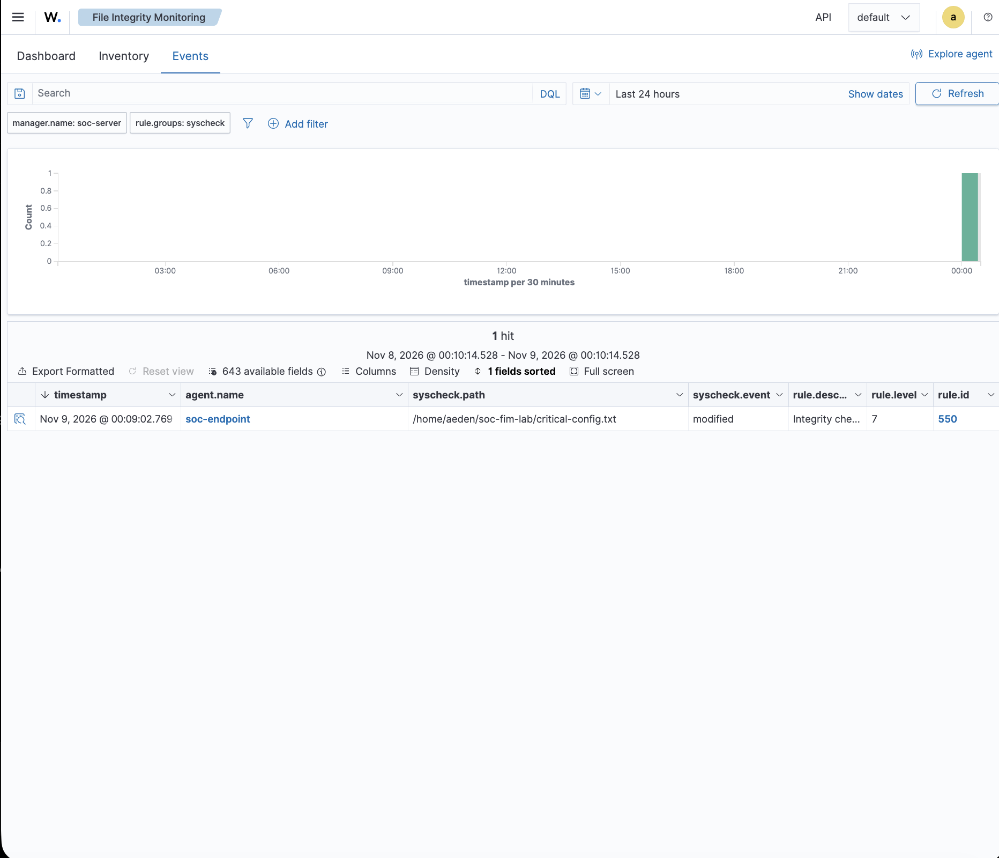
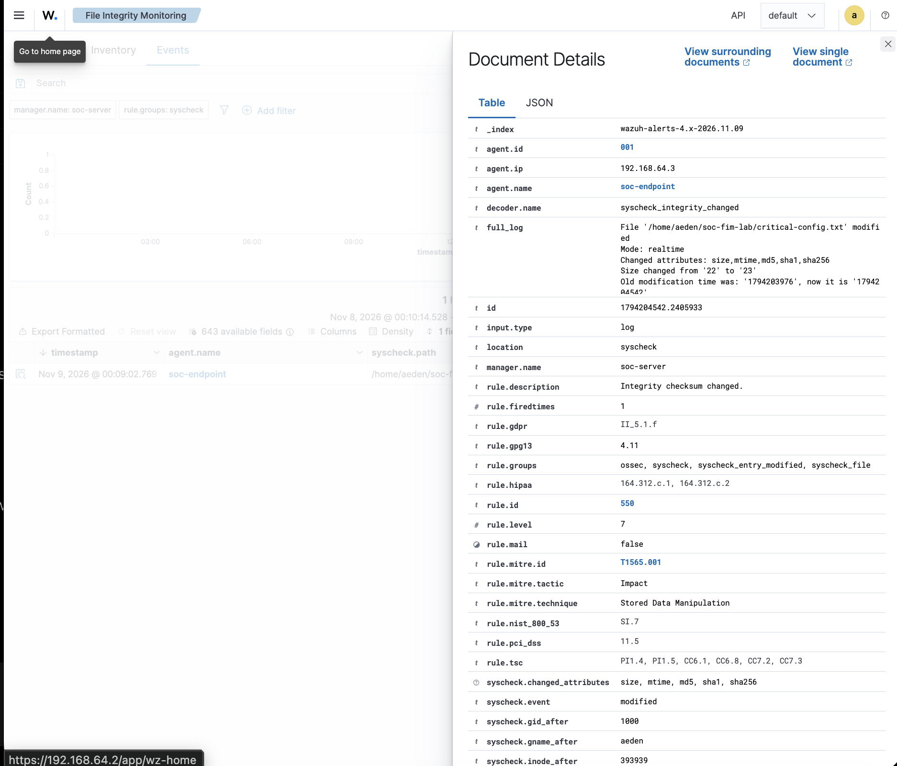

# Investigation 02: File Integrity Monitoring

## Case summary

| Field | Detail |
| --- | --- |
| Case ID | MINI-SOC-002 |
| Exercise type | Authorized file-change simulation in a personal lab |
| Objective | Validate real-time detection of a controlled change to a monitored test file |
| Wazuh manager | `192.168.64.2`; `soc-server` appears in the event |
| Monitored endpoint | `soc-endpoint`, `192.168.64.3`, agent ID `001` |
| Reported endpoint environment | Ubuntu 24.04.5 LTS; Wazuh Agent 4.14.10 |
| Test directory | `/home/aeden/soc-fim-lab/` |
| Monitored file | `/home/aeden/soc-fim-lab/critical-config.txt` |
| Detection | Rule `550`, “Integrity checksum changed.”, level `7` |
| Event / monitoring mode | `modified` / `realtime` |
| ATT&CK mapping | T1565.001 — Stored Data Manipulation; Impact tactic |
| Displayed alert time | Nov 9, 2026 @ 00:09:02.769; timezone not shown |
| Observed alert count | One matching modification alert in the displayed query window |
| Disposition | Expected detection of an authorized test; no unauthorized attack or compromise occurred, per the lab owner's account |

## Executive summary

The lab owner configured Wazuh File Integrity Monitoring (FIM) for a test directory on the Ubuntu endpoint, restarted the agent, and reported confirming that real-time monitoring started. The owner then changed a test file's content from `security_mode=enabled` to `security_mode=disabled`.

The supplied screenshots show one matching modification alert for that file: rule 550 at level 7. The expanded event reports real-time mode, changed size, modification time, MD5, SHA-1, and SHA-256 attributes, and a file-size increase from 22 to 23 bytes. It also shows the T1565.001 mapping.

This validates detection of the controlled file change. It does not establish malicious intent, show the old and new file contents, or demonstrate that a running security control was disabled. The file was a lab test artifact; no application behavior or service impact was demonstrated.

## Scope and evidence basis

The scope is a single controlled modification to `critical-config.txt` on agent `001`. The two screenshots below were inspected directly. Configuration placement, the agent restart, startup confirmation, the before/after content, and authorization come from the lab owner's test notes. No separate configuration capture, startup-log export, file copies, or full alert JSON was supplied.

Environment versions are recorded from the supplied lab details. The screenshots independently identify the agent, endpoint address, monitored path, and detection fields, but do not verify all installed versions or the manager's network configuration.

## Setup

The owner added this entry **inside the existing `<syscheck>` section** of the endpoint's `/var/ossec/etc/ossec.conf`:

```xml
<directories check_all="yes" realtime="yes">/home/aeden/soc-fim-lab</directories>
```

This is the supplied configuration entry, not a replacement for the full agent configuration. `check_all="yes"` enables the file attribute checks, and `realtime="yes"` requests continuous directory monitoring. Wazuh documents these options in its [FIM basic settings](https://documentation.wazuh.com/current/user-manual/capabilities/file-integrity/basic-settings.html) and [syscheck reference](https://documentation.wazuh.com/current/user-manual/reference/ossec-conf/syscheck.html).

After restarting the agent, the owner reported confirming successful startup of real-time monitoring. The expanded event's `Mode: realtime` supports the monitoring mode for the detected modification; a separate startup record is not attached.

## Controlled test procedure

The completed procedure, as reported by the lab owner, was:

1. Apply the directory-monitoring configuration, restart the agent, and confirm real-time monitoring started.
2. Use `critical-config.txt` in the monitored test directory with the original value below as the controlled test's starting state.
3. Change the test file to the modified value below.
4. Review Wazuh FIM events and expand the matching modification alert.

| State | Content reported by the lab owner |
| --- | --- |
| Original | `security_mode=enabled` |
| Modified | `security_mode=disabled` |

The screenshots do **not** display these file contents or a content diff. The 22-to-23-byte change is visible in the alert and is consistent with the reported one-character length increase, but size and hashes cannot reconstruct the exact text or establish line endings. Exact editing commands and setup times were not supplied and are not reconstructed here.

## Screenshot evidence

### 1. FIM detection results



The results view shows **one hit** for the displayed window. Its row identifies `soc-endpoint`, the full test-file path, event `modified`, rule `550`, and level `7`. This supports one matching modification alert in that view. It does not establish that only one filesystem operation occurred or that no other activity occurred outside the query's scope.

### 2. Expanded FIM event



The expanded event identifies agent `001`, `soc-endpoint`, and `192.168.64.3`. Its log text shows the test-file path, `Mode: realtime`, changed attributes `size,mtime,md5,sha1,sha256`, and size changing from `22` to `23`. It confirms rule `550`, description “Integrity checksum changed.”, level `7`, and T1565.001 / Stored Data Manipulation under the Impact tactic. These fields support a detected integrity change; the screenshot provides no content diff or attribution of the editing user/process. The visible `syscheck.gname_after: aeden` field is group metadata, not proof of who edited the file.

## Timestamp and query context

| Item | Value visible in the evidence |
| --- | --- |
| Alert row timestamp | `Nov 9, 2026 @ 00:09:02.769` |
| Displayed query start | `Nov 8, 2026 @ 00:10:14.528` |
| Displayed query end | `Nov 9, 2026 @ 00:10:14.528` |
| Relative range label | `Last 24 hours` |
| Visible filters | `manager.name: soc-server` and `rule.groups: syscheck` |
| Search bar | No additional query text visible |
| Event index | `wazuh-alerts-4.x-2026.11.09` |

The screenshots do not show the dashboard timezone or UTC offset. The displayed timestamp is preserved exactly and is not labeled as UTC or America/Chicago. The index date alone does not establish the display timezone. The expanded log also contains modification-time metadata, which is a different time field from the alert row's timestamp. No timezone conversion or detection-latency calculation is asserted.

The query is scoped by manager and rule group, rather than visibly filtered to this filename or agent. Its single visible result matches the reported test. Exact test start/end times, configuration/restart times, and screenshot capture times are not established by these images.

## Detection analysis and findings

**Integrity change detected:** The file's recorded attributes changed, including its size and hash checks. Rule 550 and the `modified` event support detection of a file modification on the expected endpoint. The changed-attributes list is visible; individual old/new hash values are not shown in the supplied screenshot and are not invented.

**Real-time monitoring observed:** The event explicitly reports `realtime`. This supports the configured mode for this alert, without measuring delivery speed or proving uninterrupted monitoring of every file or change.

**Change detection versus malicious intent:** A legitimate administrator, software update, or attacker can all modify a monitored file. FIM identifies a change; deciding whether it is malicious requires authorization context, a trusted baseline, the actual modification, attribution, and related host activity. In this case, the owner supplied the authorization and controlled-test context. The alert alone would not establish those facts, and its level 7 is not a verdict that an attack occurred.

**ATT&CK context:** The event maps to [T1565.001 — Stored Data Manipulation](https://attack.mitre.org/techniques/T1565/001/), which describes adversarial manipulation of stored data. The mapping helps an analyst recognize a possible integrity-impact behavior. Its presence on an authorized test alert does not prove adversarial intent, impact, or compromise.

**Outcome:** One matching modification alert was observed, consistent with the controlled test. No unauthorized attack or compromise occurred according to the supplied exercise account. No wider incident or service impact is inferred from the test filename, content, or mapping.

## Limitations

- The screenshots are selected views, not a full export of the event or complete endpoint history.
- The configuration entry, startup confirmation, and before/after text are owner-reported; supporting captures or file copies were not supplied.
- No file-content diff, editing process, or authenticated actor is established by the attached evidence. `check_all` should not be treated as proof that content-diff collection was enabled; Wazuh documents `report_changes` separately in the [syscheck reference](https://documentation.wazuh.com/current/user-manual/reference/ossec-conf/syscheck.html).
- One matching alert is not a count of all writes or a measure of detection coverage. Creation/deletion detection, other paths, and monitoring interruptions were not evaluated here.
- Timezone, capture times, and an independently measured detection delay remain unknown.
- No baseline restoration, response action, or subsequent verification result was reported.

## Recommended SOC response

These are recommendations for handling a comparable alert, not actions performed during this investigation:

1. **Validate the change:** Confirm the endpoint, file path, and event time; check with the file owner and approved-change records. For this lab, document the known test as an expected, authorized change.
2. **Preserve and compare evidence:** Retain the relevant alert export, file metadata, and safely collected file versions. Compare with a trusted baseline and inspect the actual content before judging impact. Record timezone settings before correlating with other logs.
3. **Establish context if authorization is unclear:** Review available process/audit telemetry, authentication events, and nearby changes. Do not treat a file's owner or group as the editing actor. Assess whether an application uses the file and whether behavior changed.
4. **Respond according to the finding:** If evidence indicates unauthorized or harmful activity, escalate and contain according to the organization's procedures, preserving evidence before restoration. For the authorized lab exercise, restore the intended test baseline if needed and verify monitoring afterward; neither restoration nor a follow-up alert is claimed here.

## SOC relevance and lessons learned

This investigation practices integrity-alert triage: identify the asset and file, interpret changed attributes, evaluate authorization, and explain the limits of a detection. It complements the [SSH investigation](01-ssh-brute-force.md) by shifting from authentication activity to changes in stored data. Both require an analyst to distinguish a tool's alert from a supported conclusion about intent and impact.

## Publication review

Both screenshots were checked visually and their embedded EXIF/XMP metadata was inspected. No passwords, credentials, private keys, tokens, or public IP addresses were found. Metadata contains image dimensions/resolution, a generic “Screenshot” comment, and XMP toolkit information.

The supplied local username **`aeden` remains visible in the test path and a group field**. The exact path is intentionally retained to connect the supplied test and alert; it is a personal identifier, not an editing-user attribution. Private lab IPs, lab hostnames, and event metadata are also visible. No images were modified or redacted for this documentation milestone.
