# Investigation 03: Linux Security Hardening with Wazuh SCA

## Case summary

| Field | Detail |
| --- | --- |
| Case ID | MINI-SOC-003 |
| Exercise type | Authorized configuration assessment and remediation in a personal lab |
| Objective | Identify cron permission findings, apply targeted changes, and verify the results |
| Endpoint | `soc-endpoint`, `192.168.64.3`; agent `001` appears in Wazuh screenshots |
| Reported environment | Ubuntu Server 24.04.5 LTS; Wazuh 4.14.10 |
| Assessment | Wazuh Security Configuration Assessment (SCA) |
| Benchmark | CIS Ubuntu Linux 24.04 LTS v1.0.0, as displayed in Wazuh |
| Remediation scope | Checks `35594`–`35599`: `/etc/crontab` and five cron directories |
| Result | All six selected checks changed from Failed to Passed |
| Final assessment | 126 passed, 111 failed, 42 not applicable; displayed score 53% |
| Displayed final scan end | Nov 9, 2026 @ 00:56:48.000; timezone not shown |

## Executive summary

Wazuh SCA identified six failed cron permission checks on the lab endpoint. Terminal screenshots show `/etc/crontab` changing from mode `544` to `600` and five cron directories changing from `755` to `700`, with `root:root` ownership unchanged. Separate Wazuh screenshots confirm each selected check as Passed after remediation.

The baseline screenshot confirms 120 passed, 117 failed, 42 not applicable, and a displayed score of 50%. The final screenshot confirms 126 passed, 111 failed, 42 not applicable, and 53%. This is six additional passed checks, six fewer failed checks, and a three-percentage-point increase at the dashboard's displayed precision. Earlier score changes are outside this investigation and are not attributed to these fixes.

This exercise documents a specific improvement in configuration posture. It does not demonstrate that the whole endpoint is secure or fully CIS compliant: 111 checks remained failed in the final assessment. It is a hardening exercise, not evidence of an attack or compromise.

## Scope and evidence basis

All **14 screenshots** in `evidence/03-linux-hardening/` were reviewed: one baseline dashboard summary, one initial failed-check list, six terminal permission captures, and six Wazuh Passed-check captures. The newly supplied baseline was copied byte-for-byte into the evidence folder as `sca-baseline-before-remediation.png`, preserving the original outside the project. Existing image filenames and contents remain unchanged.

The baseline dashboard identifies `soc-endpoint (001)`, the benchmark, aggregate totals, and a scan-end timestamp. The separate initial failed-check list independently shows all six selected checks as Failed; that crop does not show totals, a timestamp, or endpoint identity. The post-remediation captures identify the endpoint, benchmark, each passing check, and intermediate/final totals. OS/Wazuh versions and the endpoint IP are supplied environment details, not independently established by these screenshots.

This report covers only the six permission changes. It does not explain other findings or any assessment changes before the documented baseline. No full policy export, scan history, or cron workload test was supplied.

## Initial findings and comparison

| Metric | Before: baseline Wazuh screenshot | After: final Wazuh screenshot | Change |
| --- | --- | --- | --- |
| Passed | 120 | 126 | +6 |
| Failed | 117 | 111 | −6 |
| Not applicable | 42 | 42 | 0 |
| Total checks | 279 | 279 | 0 |
| Displayed score | 50% | 53% | +3 percentage points |

Scores are recorded as displayed; no alternative rounding or scoring formula is assumed. A benchmark score measures assessment results, not the percentage of the system that is secure. “Not applicable” is recorded as its own category, not counted as a remediated finding.

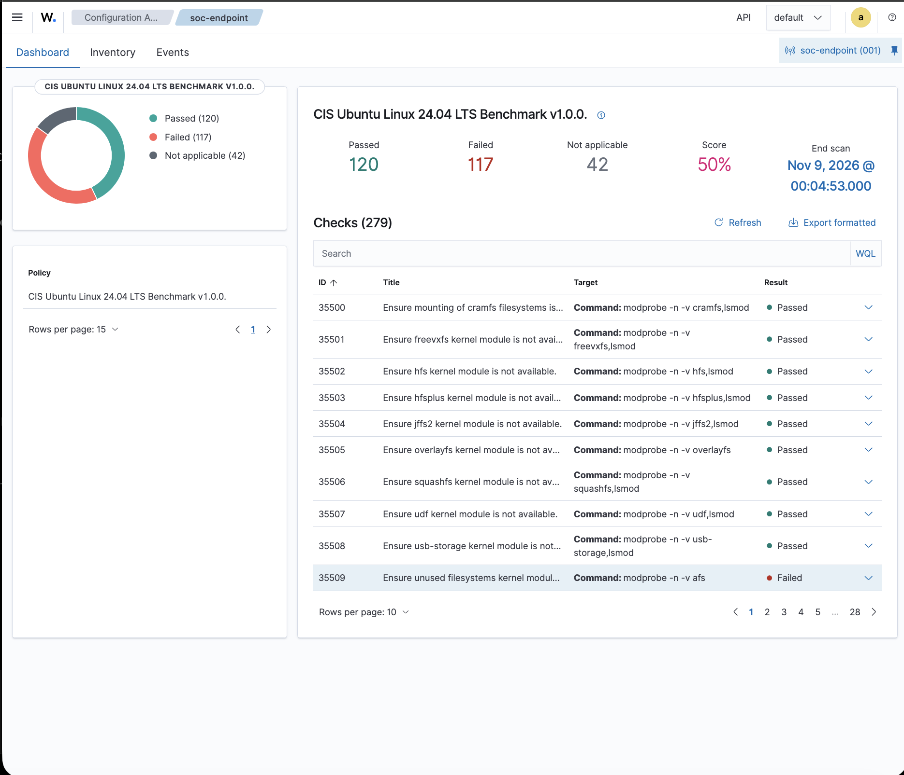

This capture confirms the original aggregate baseline for `soc-endpoint (001)` under CIS Ubuntu Linux 24.04 LTS Benchmark v1.0.0. Its displayed scan end is **Nov 9, 2026 @ 00:04:53.000**, with no timezone shown. The visible list contains other benchmark checks; the six cron failures are established by the separate capture below. Those other checks do not establish the cause of any earlier score changes.

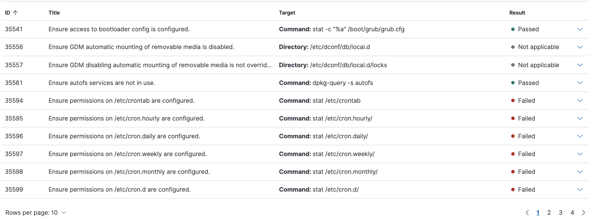

This capture confirms the six selected cron permission findings were Failed. Other visible checks are outside the remediation scope; their presence does not establish what caused any earlier score changes.

### Verified permission changes

Modes below are octal permission values. Every terminal capture shows `root:root` before and after.

| SCA check | Target | Before | After | Wazuh result |
| --- | --- | --- | --- | --- |
| 35594 | `/etc/crontab` | `544` (`r-xr--r--`) | `600` (`rw-------`) | Failed → Passed |
| 35595 | `/etc/cron.hourly` | `755` (`rwxr-xr-x`) | `700` (`rwx------`) | Failed → Passed |
| 35596 | `/etc/cron.daily` | `755` (`rwxr-xr-x`) | `700` (`rwx------`) | Failed → Passed |
| 35597 | `/etc/cron.weekly` | `755` (`rwxr-xr-x`) | `700` (`rwx------`) | Failed → Passed |
| 35598 | `/etc/cron.monthly` | `755` (`rwxr-xr-x`) | `700` (`rwx------`) | Failed → Passed |
| 35599 | `/etc/cron.d` | `755` (`rwxr-xr-x`) | `700` (`rwx------`) | Failed → Passed |

## Why cron permissions matter

Cron schedules commands that can run with privileged accounts. `/etc/crontab` and `/etc/cron.d` hold system scheduling definitions, while the periodic directories hold jobs used by the scheduling setup. Restricting access reduces unnecessary exposure of job names, schedules, and commands and reserves administration to the intended owner. Ubuntu's [cron manual](https://manpages.ubuntu.com/manpages/noble/man8/cron.8.html) describes the system scheduling locations.

For `/etc/crontab`, mode `600` gives the root owner read/write access, removes the unnecessary owner execute bit, and removes group/other read access. A crontab is configuration data; it does not need to be executable as a program. For the root-owned directories, `700` retains root read/write/search access and removes group/other directory listing and traversal permissions. A directory's execute bit controls traversal, rather than execution of the directory as a program.

The original `544` and `755` modes **did not grant group or other write access**. These fixes should not be described as closing a demonstrated world-writable cron vulnerability. Their verified effect was tighter access and alignment with the six SCA checks. Restricting directory access also does not change permissions of every file within it, prevent a privileged attacker from editing jobs, or disable users' separate personal crontabs.

## Remediation commands and local verification

The following six `chmod` commands are visible in the supplied terminal captures. They document work already performed on the Ubuntu endpoint; no commands were run against the VMs while writing this report.

```bash
sudo chmod 600 /etc/crontab
sudo chmod 700 /etc/cron.hourly
sudo chmod 700 /etc/cron.daily
sudo chmod 700 /etc/cron.weekly
sudo chmod 700 /etc/cron.monthly
sudo chmod 700 /etc/cron.d
```

Each capture uses `stat` before and after its change. The recorded format is:

```bash
sudo stat -c '%a %U:%G %n' /etc/crontab
```

The same format is shown with each directory's path. It reports numeric mode, owner/group, and target name. The changes were targeted and non-recursive; no ownership change or modification of the cron job contents is claimed.

### Check 35594 — `/etc/crontab`

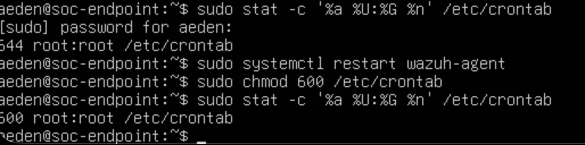

The terminal shows `544 root:root`, the command `sudo chmod 600 /etc/crontab`, and `600 root:root` afterward. It also shows an agent restart **before** this permission change; it does not establish that this restart triggered the later scan.

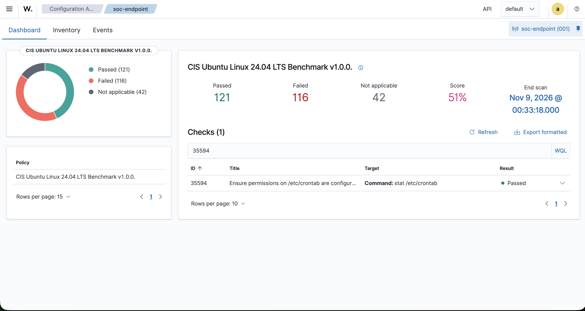

Wazuh confirms check 35594 as Passed. This is an intermediate assessment with 121 passed, 116 failed, 42 not applicable, and a displayed score of 51%.

### Check 35595 — `/etc/cron.hourly`

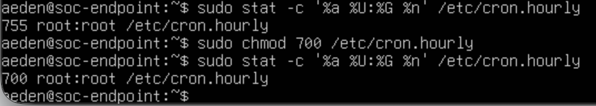

The terminal confirms the targeted `755` → `700` change and unchanged `root:root` ownership.

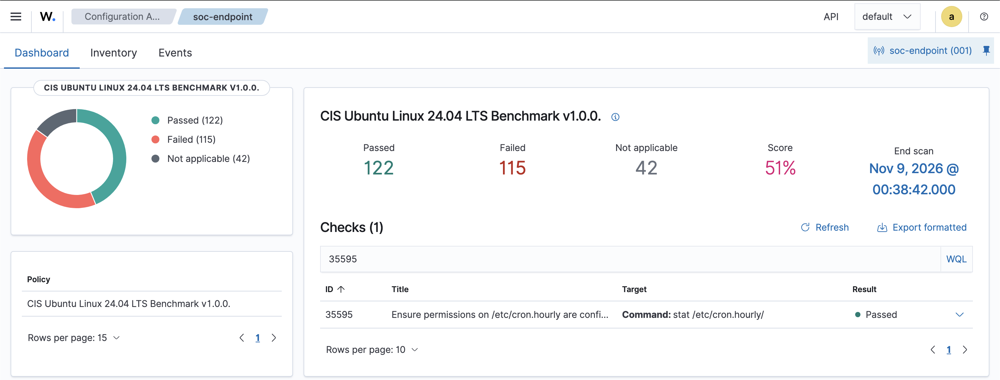

Wazuh confirms check 35595 as Passed, with 122 passed, 115 failed, 42 not applicable, and a displayed score of 51%.

### Check 35596 — `/etc/cron.daily`

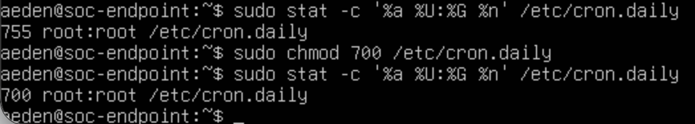

The terminal confirms the `chmod 700` command and the resulting `700 root:root` mode.

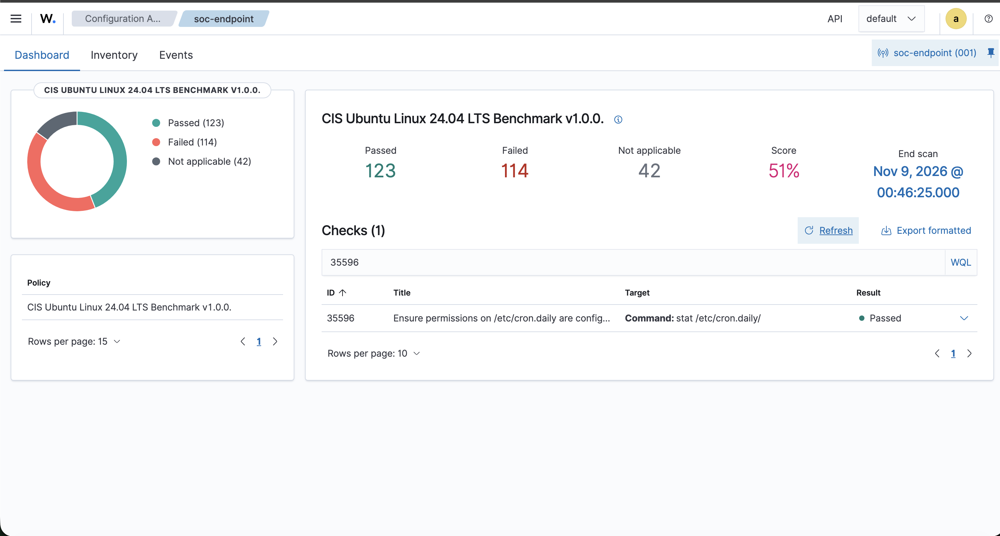

Wazuh confirms check 35596 as Passed, with 123 passed, 114 failed, 42 not applicable, and a displayed score of 51%.

### Check 35597 — `/etc/cron.weekly`

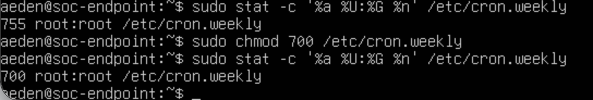

The terminal confirms the targeted `755` → `700` change with ownership preserved.

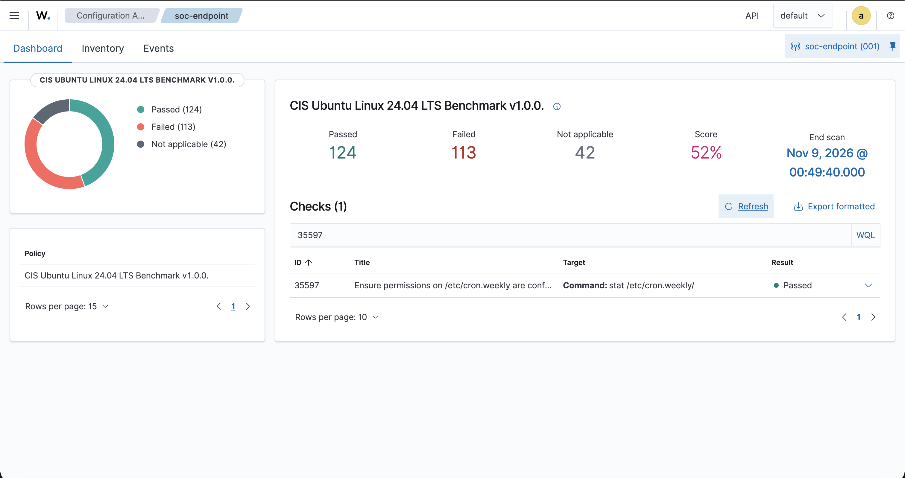

Wazuh confirms check 35597 as Passed, with 124 passed, 113 failed, 42 not applicable, and a displayed score of 52%.

### Check 35598 — `/etc/cron.monthly`

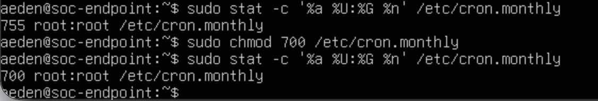

The terminal confirms `755 root:root` before the change and `700 root:root` afterward.

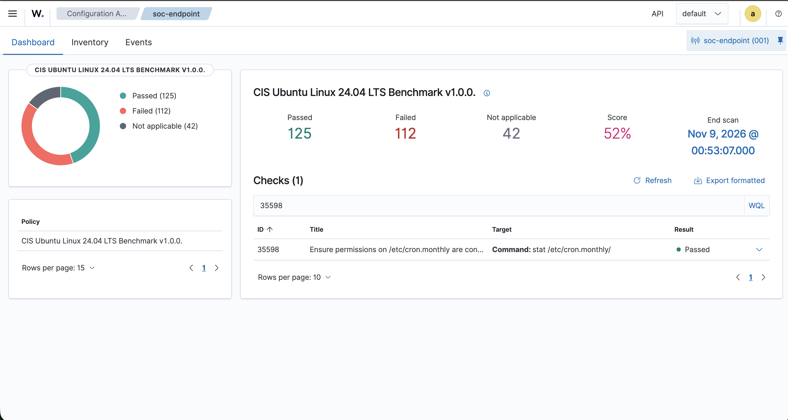

Wazuh confirms check 35598 as Passed, with 125 passed, 112 failed, 42 not applicable, and a displayed score of 52%.

### Check 35599 — `/etc/cron.d` and final results

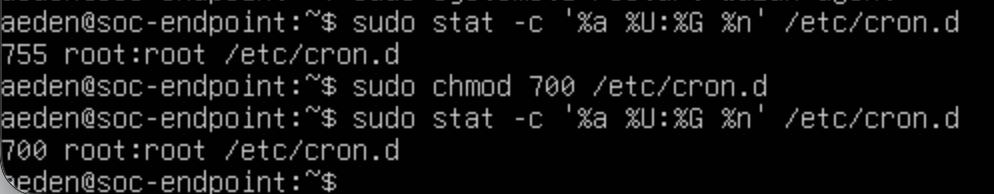

The terminal confirms the final targeted directory permission change to `700 root:root`.

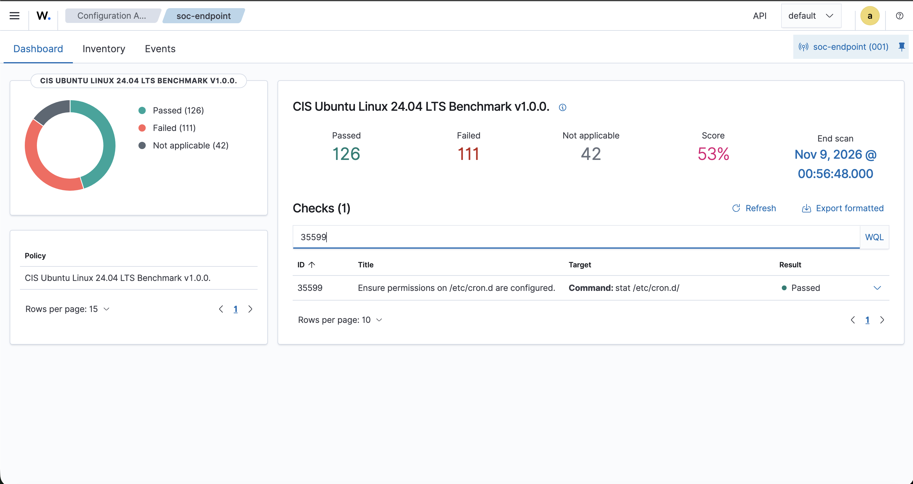

The last capture confirms check 35599 as Passed and the final assessment totals. The list is filtered to one check; the visible summary covers the benchmark assessment, not just that filtered row. The separate captures above establish the other five passing results at their respective scan times.

## Assessment verification and timestamps

Wazuh [SCA checks](https://documentation.wazuh.com/current/user-manual/capabilities/sec-config-assessment/how-it-works.html) evaluate endpoint configuration against policy rules and return Passed, Failed, or Not applicable. Local `stat` output verifies the permission change; a subsequent SCA result verifies the selected check's assessment. These are complementary forms of evidence.

| Assessment stage / check shown | Displayed scan end on Nov 9, 2026 | Passed | Failed | Not applicable | Displayed score |
| --- | --- | --- | --- | --- | --- |
| Baseline | `00:04:53.000` | 120 | 117 | 42 | 50% |
| 35594 | `00:33:18.000` | 121 | 116 | 42 | 51% |
| 35595 | `00:38:42.000` | 122 | 115 | 42 | 51% |
| 35596 | `00:46:25.000` | 123 | 114 | 42 | 51% |
| 35597 | `00:49:40.000` | 124 | 113 | 42 | 52% |
| 35598 | `00:53:07.000` | 125 | 112 | 42 | 52% |
| 35599 | `00:56:48.000` | 126 | 111 | 42 | 53% |

These are dashboard **scan-end times**, not command execution or screenshot capture times. No timezone or UTC offset is visible, so the values are preserved without conversion and are not labeled UTC or America/Chicago. The initial crop and terminal captures supply no timestamps. The exact mechanism used to trigger each later scan is not established by the evidence; no repeated restart commands are invented.

## Findings, limitations, and follow-up

The evidence supports six individual Failed → Passed transitions, backed by terminal verification of the intended modes. The progression is consistent with the six-check improvement from the pictured baseline. It does not attribute earlier score changes, prove that no other settings changed between scans, or establish the contents of all 279 checks.

The final assessment still contains **111 failed checks**. Full CIS compliance, absence of vulnerabilities, absence of compromise, and successful execution of scheduled workloads have not been established. Child file modes, ACLs, job contents, and other scheduling controls were not independently audited here.

Recommended next steps, not completed results, are to retain a full assessment export with scan identifiers and timezone context, confirm required cron jobs still operate, and prioritize the remaining findings according to exposure and operational impact. Future changes should be tested against legitimate service requirements and verified with both local checks and a new assessment. Preserve the baseline screenshot alongside any available assessment exports.

## Defensive cybersecurity and SOC relevance

This exercise practices a remediation workflow: identify misconfiguration findings, understand their access-control implications, apply scoped changes, and verify closure with evidence. In a SOC or security operations team, analysts may validate findings and track remediation while system owners apply approved changes. Benchmark results help guide that work but do not replace incident investigation, vulnerability assessment, or operational testing.

Together with the [SSH](01-ssh-brute-force.md) and [FIM](02-file-integrity-monitoring.md) investigations, this case adds preventive configuration management to the lab's detection and analysis work.

## Publication review

The screenshots and embedded EXIF/XMP metadata were reviewed. No passwords, tokens, private keys, or public IP addresses were found. A sudo password **prompt** is visible in the crontab terminal capture, but no password value is displayed.

The local username **`aeden`** is visible in terminal prompts, alongside the lab hostname `soc-endpoint` and `root:root` ownership. This personal identifier is retained and disclosed here, consistent with the existing FIM evidence. Metadata contains image dimensions/resolution, a generic “Screenshot” comment, and XMP toolkit information. No evidence images were edited or redacted.
